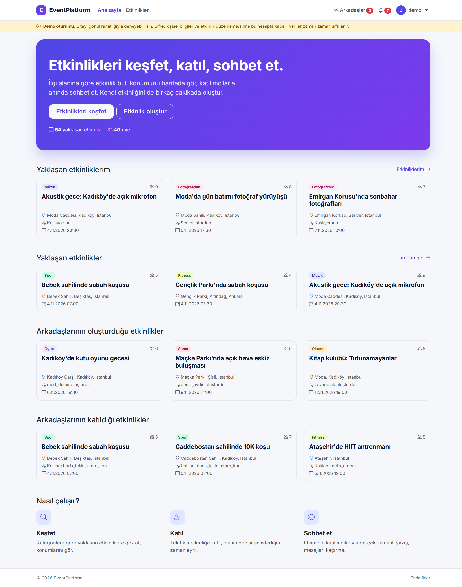
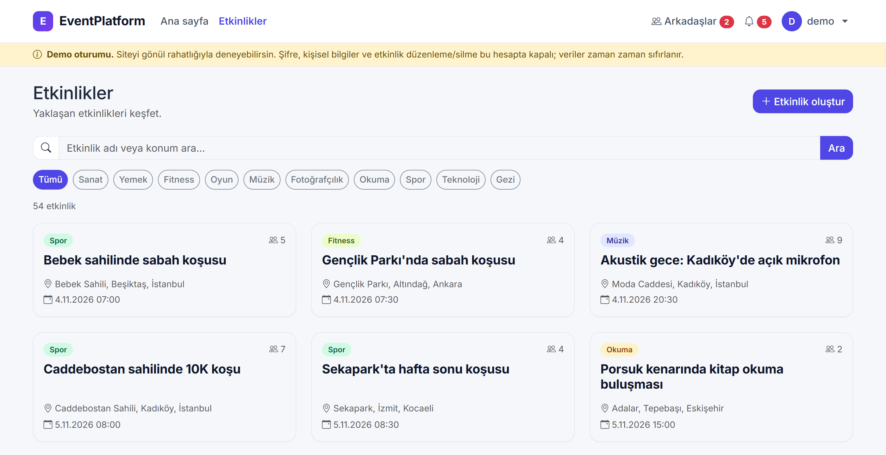
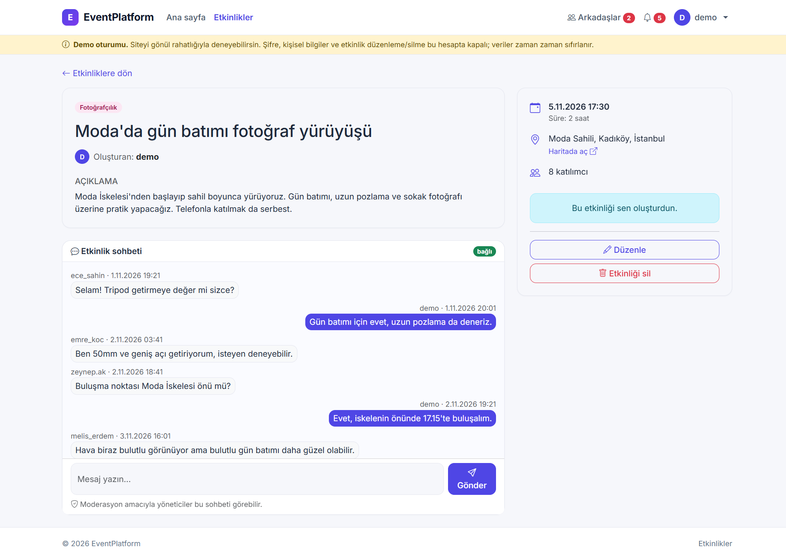
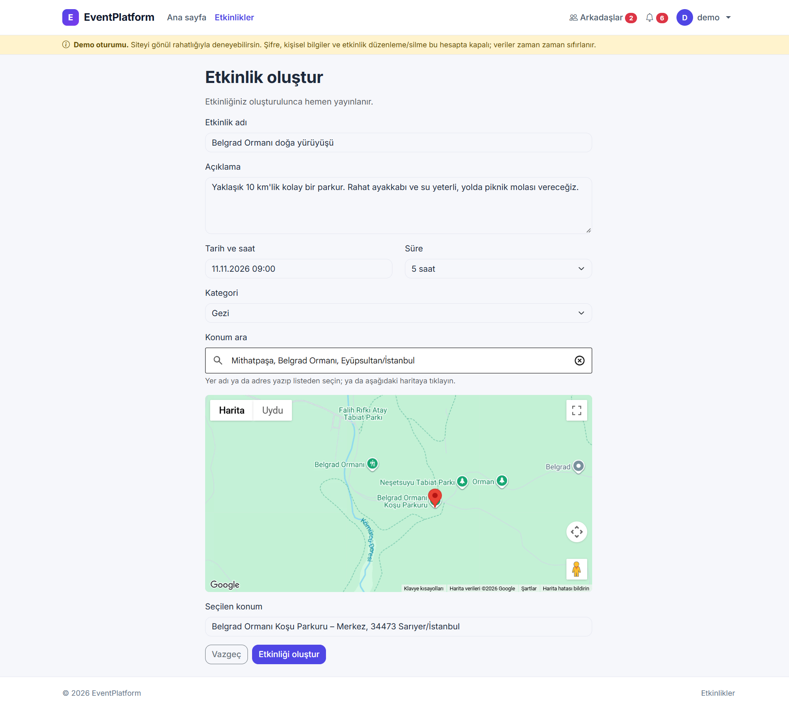
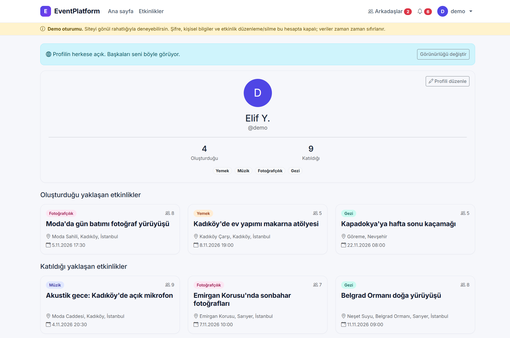
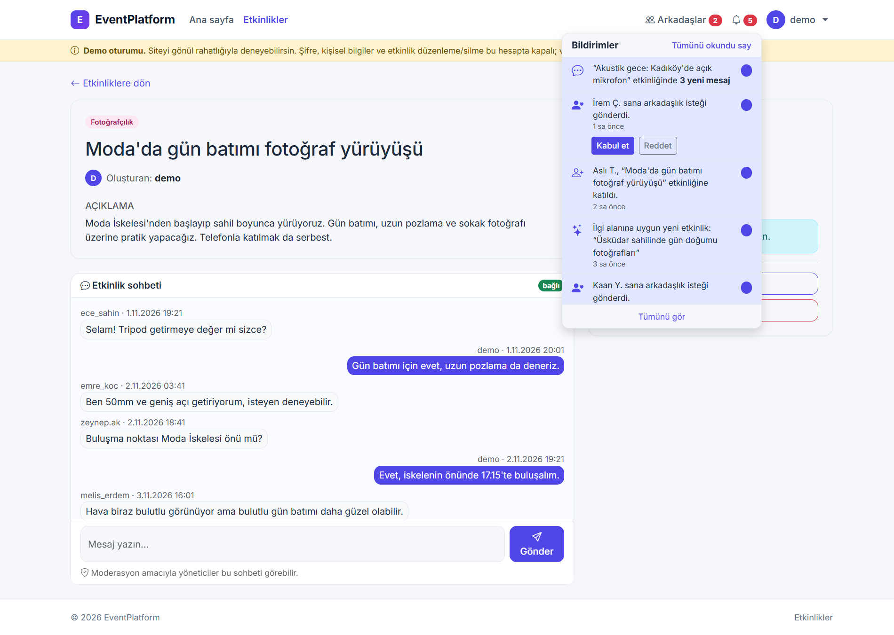
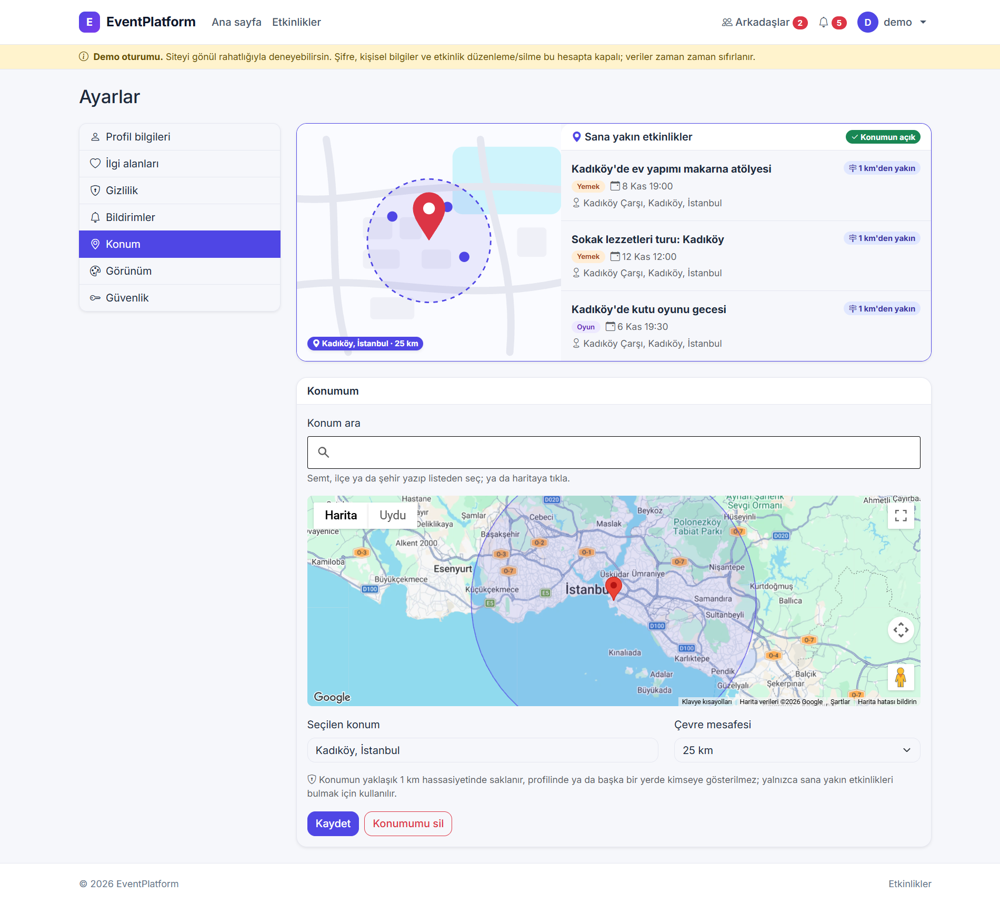
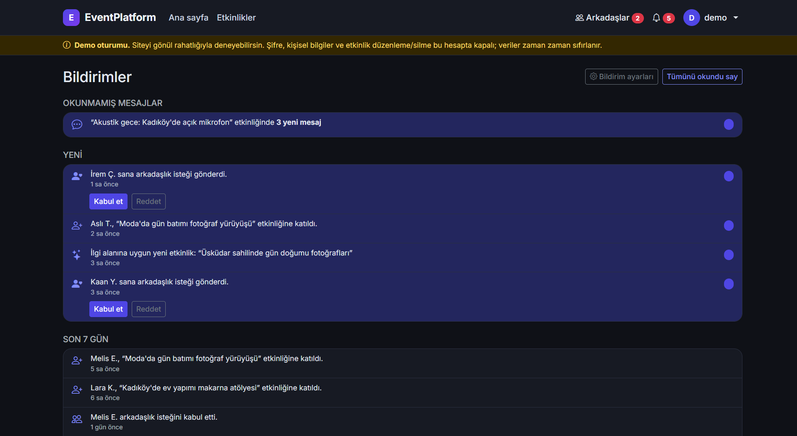

# EventPlatform

[](https://github.com/KutayP/EventPlatform/actions/workflows/ci.yml)

A full-stack social event platform: users discover and create events, join them, chat with other participants in real time, add friends, and get notified about activity and new events near them that match their interests.

**Live demo:** https://eventplatform-wvls.onrender.com

**Demo login:** `demo` / `Demo1234!` (password, personal info and editing/deleting the sample events are disabled for this account; events you create yourself can be edited and deleted; the sample data is reset every night)

> The demo runs on free hosting tiers. If it has been idle, the first request can take up to a minute while the server and database wake up.



## Features

- **Events:** create events with a Google Maps location picker, browse, search and filter by category; readable, non-sequential URLs (`/events/kadikoy-sahil-yuruyusu-k7x2m9ab`); "My events" page; upcoming events I created or joined are shown on the home page as a reminder
- **Participation and chat:** join / leave events; one real-time chat room per event (SignalR / WebSockets) with message history and unread tracking
- **Profiles and privacy:** public profile pages (`/u/username`) that can be limited to friends only; only first name and last initial are shown, never e-mail, birth date or gender
- **Friends:** friend requests (send, accept, decline, cancel, remove), typo-tolerant user search (PostgreSQL `pg_trgm`, Turkish-character aware), a home feed of events my friends created or joined
- **Notifications:** real-time bell with unread badge (SignalR) for new participants, friend requests (accept / decline right in the dropdown), accepted requests, unread chat messages and recommended events; a full notification history page
- **Recommendations:** users can opt in to notifications for new events in their interests within a chosen distance of their location; the location settings page previews nearby upcoming events
- **Settings:** profile info, interests, profile visibility, notification types, location and radius, appearance (light / dark / follow device, with selectable color palettes), password change with show / hide toggle
- **Moderation:** events publish immediately; admins can unpublish or delete them and read an event's chat in read-only mode
- **REST API:** a versioned JSON API (`/api/v1`) with JWT authentication and interactive documentation (see below)

| Events | Event details and chat |
|---|---|
|  |  |

| Create event with map | Profile |
|---|---|
|  |  |

| Notifications | Location and nearby events |
|---|---|
|  |  |

| Dark theme |
|---|
|  |

## Tech stack

| Area | Technology |
|---|---|
| Backend | .NET 10, ASP.NET Core MVC, SignalR |
| Data | Entity Framework Core (database-first), PostgreSQL (Neon), `pg_trgm` |
| Frontend | Razor views, Bootstrap 5.3 (color modes), Bootstrap Icons, vanilla JavaScript, flatpickr |
| Maps | Google Maps JavaScript API (Places, Geocoding) |
| Auth | Cookie authentication (site), JWT bearer tokens (API), BCrypt password hashing |
| API docs | OpenAPI (`Microsoft.AspNetCore.OpenApi`), Scalar |
| Testing / CI | xUnit, GitHub Actions (build, tests, Docker image build) |
| Deployment | Docker, Render |

## REST API

Interactive documentation: **https://eventplatform-wvls.onrender.com/api/docs/v1** (OpenAPI document: `/openapi/v1.json`).

| Method | Endpoint | Auth | Description |
|---|---|---|---|
| `POST` | `/api/v1/auth/token` | – | Exchange username and password for a JWT (valid for 1 hour) |
| `GET` | `/api/v1/categories` | – | Valid category values |
| `GET` | `/api/v1/events?q=&category=&page=&pageSize=` | – | Upcoming published events, paged (`pageSize` 1–50) |
| `GET` | `/api/v1/events/{publicId}` | – | Event details |
| `POST` | `/api/v1/events/{publicId}/participation` | JWT | Join an event (the creator is notified) |
| `DELETE` | `/api/v1/events/{publicId}/participation` | JWT | Leave an event |
| `GET` | `/api/v1/me/events` | JWT | My upcoming events (created and joined) |

Example with the demo account:

```bash
curl -X POST https://eventplatform-wvls.onrender.com/api/v1/auth/token \
  -H "Content-Type: application/json" \
  -d '{"username":"demo","password":"Demo1234!"}'

curl https://eventplatform-wvls.onrender.com/api/v1/me/events \
  -H "Authorization: Bearer <accessToken>"
```

Status codes: `200` / `204` on success, `400` invalid parameters (an unknown category lists the valid values), `401` missing or invalid token, `404` unknown event, `409` already joined / not joined / own event, `429` too many login attempts. Error bodies use `application/problem+json` (RFC 9457).

## Security and privacy

- Passwords hashed with BCrypt; identical error message for unknown user and wrong password
- Anti-forgery tokens on all state-changing requests; open-redirect protection (`Url.IsLocalUrl`)
- Server-side validation with view models (no over-posting; roles and ownership are never taken from forms)
- Ownership and access checks inside the database queries (editing, deleting, notifications, friend requests); someone else's resource returns 404
- Output encoding in Razor and `textContent` in chat to prevent XSS; the notification dropdown is rendered on the server, not built from strings in JavaScript
- Cookies: `HttpOnly`, `Secure`, `SameSite=Lax`, sliding expiration
- Chat authorization re-checked on the server for every hub call (only the creator and participants of a published event)
- Event URLs use a random 8-character code instead of sequential ids
- Profile visibility (public / friends only); the user's location is stored rounded to about 1 km, shown to no one and used only for matching
- Search input is passed only as SQL parameters; `LIKE` wildcards are escaped
- API: separate JWT bearer scheme only on `/api` endpoints (no cookies, so no CSRF exposure), HMAC-SHA256 signing key from configuration, issuer / audience / lifetime validated; the login endpoint is rate-limited per IP (10 requests per minute) and takes the same time for unknown users and wrong passwords
- Duplicate submissions: submit buttons are locked after the first click, and a unique index on (creator, name, date, location) makes event creation idempotent on the server
- Data-protection keys stored in the database and encrypted with a certificate, so sessions survive restarts
- The public demo account cannot change its password or personal info, or edit / delete the sample events (checked on the server, with a banner on every page)
- All secrets (connection string, API keys, certificate) come from user-secrets locally and environment variables in production; none are committed

## Run locally

Requirements: .NET 10 SDK and a PostgreSQL database (with the `pg_trgm` extension).

```cmd
cd EventPlatform.Web
dotnet user-secrets init
dotnet user-secrets set "ConnectionStrings:DefaultConnection" "<your PostgreSQL connection string>"
dotnet user-secrets set "GoogleMaps:ApiKey" "<your Google Maps API key>"
dotnet user-secrets set "Jwt:SigningKey" "<random string, at least 32 characters>"
dotnet run
```

Then open http://localhost:5120 (API docs: http://localhost:5120/api/docs/v1).

Run the tests from the repository root:

```cmd
dotnet test
```

## Deployment

The app is containerized (`Dockerfile`) and deployed on Render, with PostgreSQL on Neon. Configuration is supplied through environment variables (`ConnectionStrings__DefaultConnection`, `GoogleMaps__ApiKey`, `Jwt__SigningKey`, `DataProtection__CertificateBase64`, `DataProtection__CertificatePassword`). `/healthz` is the health-check endpoint. GitHub Actions builds the solution, runs the tests and builds the Docker image on every push to `main`; a second scheduled workflow reloads the demo data from [`db/seed.sql`](db/seed.sql) every night (secrets: `DEMO_DATABASE_URL`, `DEMO_ADMIN_PASSWORD`, `DEMO_SAMPLE_USER_PASSWORD`).

## Design notes

Architecture decisions, database choices and the reasoning behind the security and privacy measures are written down in [docs/PROJE-NOTLARI.md](docs/PROJE-NOTLARI.md) (in Turkish).
