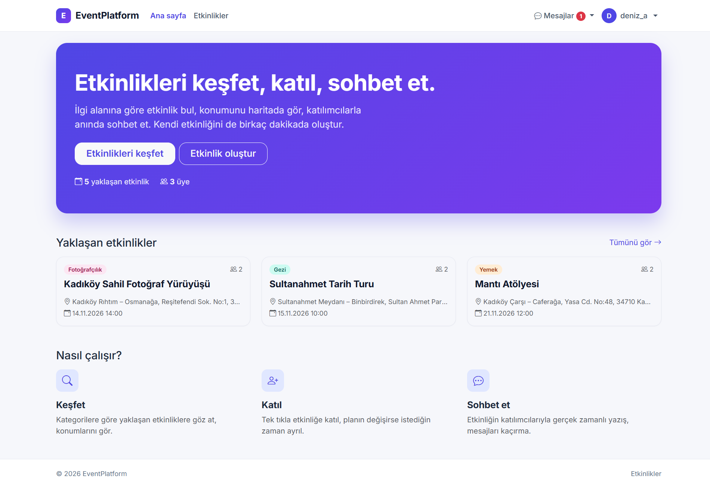
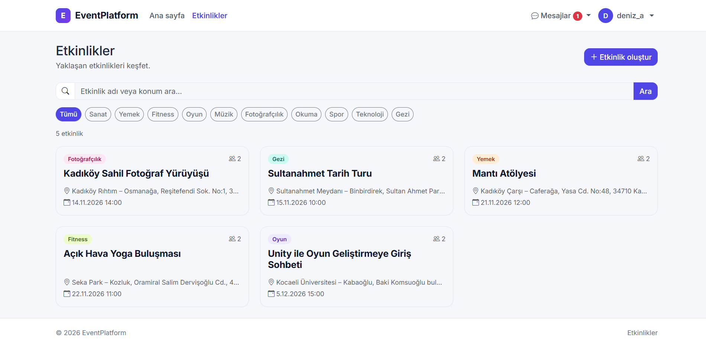
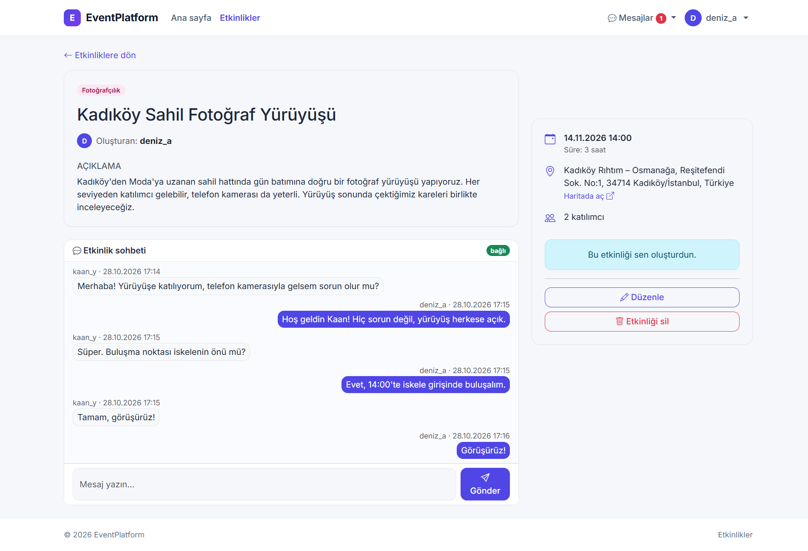
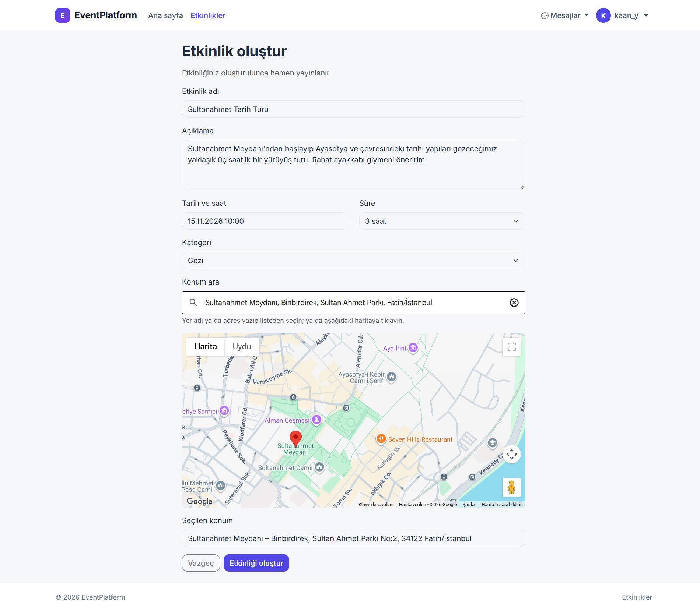
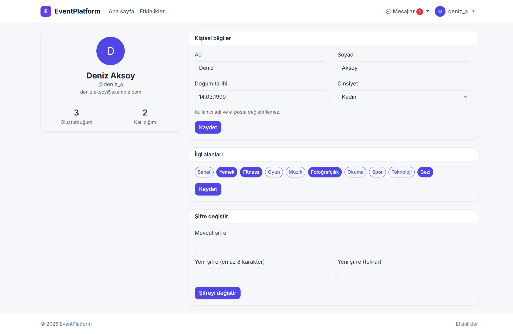

# EventPlatform

A full-stack event platform where users discover events, join them, and chat with other participants in real time.

**Live demo:** https://eventplatform-wvls.onrender.com

> The demo runs on free hosting tiers. If it has been idle, the first request can take up to a minute while the server and database wake up.



## Features

- **Accounts:** registration with interest selection, login/logout, profile editing, password change, role-based access (user / admin)
- **Events:** create events with a Google Maps location picker, browse and search, filter by category
- **Participation:** join and leave events, participant counts
- **Real-time chat:** one chat room per event (SignalR / WebSockets), message history, unread-message badge in the navigation bar
- **Profile:** edit personal info and interests, change password

| Events | Event details and chat |
|---|---|
|  |  |

| Create event with map | Profile |
|---|---|
|  |  |

## Tech stack

| Area | Technology |
|---|---|
| Backend | .NET 10, ASP.NET Core MVC, SignalR |
| Data | Entity Framework Core (database-first), PostgreSQL (Neon) |
| Frontend | Razor views, Bootstrap 5.3, Bootstrap Icons, vanilla JavaScript, flatpickr |
| Maps | Google Maps JavaScript API (Places, Geocoding) |
| Auth | Cookie authentication, BCrypt password hashing |
| Deployment | Docker, Render |

## Security

- Passwords hashed with BCrypt; identical error message for unknown user and wrong password
- Anti-forgery tokens on all state-changing requests; open-redirect protection on login
- Server-side validation with view models (no over-posting; roles are never taken from forms)
- Output encoding in Razor and `textContent` in chat to prevent XSS
- Cookies: `HttpOnly`, `Secure`, `SameSite=Lax`, sliding expiration
- Chat authorization re-checked on the server for every hub call (only the creator and approved participants)
- Data-protection keys stored in the database and encrypted with a certificate, so sessions survive restarts
- All secrets (connection string, API keys, certificate) come from user-secrets locally and environment variables in production; none are committed

## Run locally

Requirements: .NET 10 SDK and a PostgreSQL database.

```cmd
cd EventPlatform.Web
dotnet user-secrets init
dotnet user-secrets set "ConnectionStrings:DefaultConnection" "<your PostgreSQL connection string>"
dotnet user-secrets set "GoogleMaps:ApiKey" "<your Google Maps API key>"
dotnet run
```

Then open http://localhost:5120.

## Deployment

The app is containerized (`Dockerfile`) and deployed on Render, with PostgreSQL on Neon. Configuration is supplied through environment variables (`ConnectionStrings__DefaultConnection`, `GoogleMaps__ApiKey`, `DataProtection__CertificateBase64`, `DataProtection__CertificatePassword`). `/healthz` is the health-check endpoint.

## Design notes

Architecture decisions, database choices and the reasoning behind the security measures are written down in [docs/PROJE-NOTLARI.md](docs/PROJE-NOTLARI.md) (in Turkish).